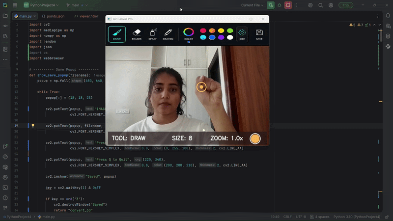

# Air Canvas 3D

Draw in the air with your finger, then turn your doodle into an interactive 3D model.

**Live demo (no install):** https://nidhi-sahare.github.io/air-canvas-3d/



## Two ways to use it

### 1) In the browser (recommended)
Open the live demo, click **Enable Camera**, allow access, and start drawing.
Everything (hand tracking, drawing and the 3D view) runs in your browser — your video never leaves your device.
Works best in Chrome / Edge, in good light, with your hand about an arm's length from the camera.

### 2) Desktop version (Python + OpenCV)
```bash
git clone https://github.com/Nidhi-Sahare/air-canvas-3d
cd air-canvas-3d
python -m venv .venv && source .venv/bin/activate   # Windows: .venv\Scripts\activate
pip install -r requirements.txt
python main.py
```
Python 3.9 – 3.12 recommended. Press `3` to convert to 3D — the 3D viewer opens automatically.

## Gestures

| Gesture | What it does |
|---|---|
| ☝️ Index finger only | Draw |
| ✌️ Index + middle | Select tools / colors / sizes (hold over a button briefly) |
| 🤟 Index + middle + ring | Zoom — change the thumb ↔ index distance |
| ☝️ in 3D view | Rotate the model |

## Keyboard shortcuts

| Key | Action |
|---|---|
| `R` | Clear canvas |
| `3` | Convert to 3D / back to canvas |
| `U` | Undo (web) |
| `S` | Save image |
| `Esc` | Back to canvas (web) |
| `Q` | Quit (desktop) |

## Features
- Hand tracking with MediaPipe (smoothed, flicker-free finger detection)
- Tools: draw, eraser, spray, crayon, rainbow color, 5 brush sizes
- Zoom gesture, undo, save as PNG
- Convert a 2D sketch into a 3D model (Solid, Neon, Layers and Relief styles)

## Project files

| File | Purpose |
|---|---|
| `index.html` | The web app (GitHub Pages serves this) |
| `main.py` | Desktop version (OpenCV window) |
| `viewer.html` | 3D viewer used by the desktop version |
| `toolbar.png` | Toolbar image used by `main.py` |
| `requirements.txt` | Python dependencies for the desktop version |

## Tech stack
MediaPipe Hands · Three.js · HTML5 Canvas · Python (OpenCV, NumPy)

## Author
Nidhi Sahare
